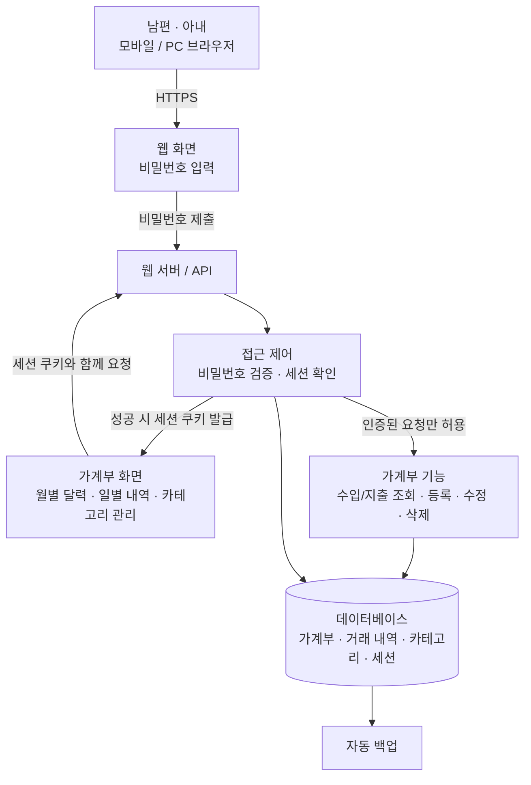
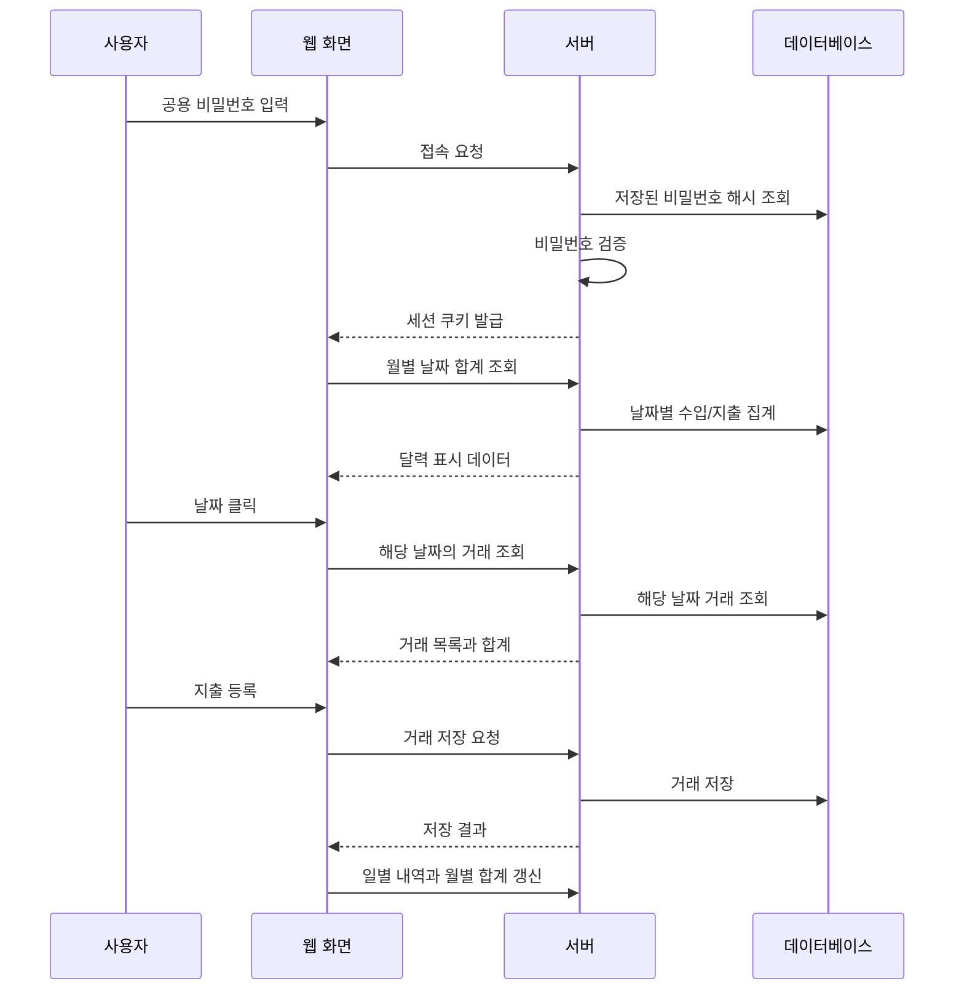

# 부부 공유 가계부 웹 서비스 아키텍처

## 1. 서비스 개요

부부가 하나의 공용 비밀번호로 접속하여 같은 가계부를 사용하는 웹 서비스입니다. 회원가입이나 개별 계정 없이 비밀번호 확인 후 서버가 세션을 발급합니다. 한 부부가 사용하는 가계부 하나를 초기 범위로 합니다.

- 모바일 및 PC 웹 브라우저 지원
- 월별 달력에서 날짜별 수입·지출 합계 표시
- 날짜 클릭 시 해당 일자의 수입·지출 내역 표시
- 거래 등록·수정·삭제 및 카테고리 관리
- 두 기기에서 동일한 서버와 데이터베이스 사용

## 2. 전체 아키텍처

초기에는 웹 화면과 API를 하나의 애플리케이션으로 배포합니다. 별도 인증 서버나 마이크로서비스는 필요하지 않습니다.

## 3. 화면 구성

| 화면 | 주요 기능 |
|---|---|
| 비밀번호 입력 | 공용 비밀번호로 접속, 일정 기간 접속 유지 |
| 월별 달력 | 날짜별 수입·지출 합계, 이전/다음 달 이동 |
| 일별 상세 | 선택 날짜의 거래 목록과 합계, 등록·수정·삭제 |
| 거래 입력 | 수입/지출 구분, 금액, 카테고리, 메모, 날짜 |
| 카테고리 관리 | 추가, 이름 변경, 정렬, 비활성화 |

PC에서는 달력 아래 또는 옆에 일별 상세를 표시합니다. 모바일에서는 달력 → 날짜 선택 → 하단 상세 목록으로 구성합니다.

## 4. 사용 흐름

## 5. 데이터 구조

| 테이블 | 주요 필드 | 용도 |
|---|---|---|
| `households` | `id`, `name`, `password_hash`, `timezone` | 공유 가계부와 접속 비밀번호 |
| `sessions` | `token_hash`, `household_id`, `expires_at` | 인증된 접속 유지 |
| `categories` | `id`, `household_id`, `type`, `name`, `sort_order`, `is_active` | 수입/지출 카테고리 |
| `transactions` | `id`, `household_id`, `category_id`, `type`, `amount`, `transaction_date`, `memo`, `version`, `created_at`, `updated_at` | 실제 거래 내역 |

### 데이터 설계 원칙

- 원화만 사용한다면 금액은 정수로 저장합니다.
- 달력 기준 거래 날짜는 `DATE`로 저장하고 생성·수정 시각과 구분합니다.
- 기존 거래를 보존하도록 카테고리는 삭제 대신 비활성화합니다.
- `version`으로 동시 수정 충돌을 감지하여 상대방의 수정 내용을 덮어쓰지 않도록 합니다.
- `transactions(household_id, transaction_date)`에 인덱스를 둡니다.
- 거래의 카테고리는 같은 가계부에 속해야 하며 수입/지출 구분이 일치해야 합니다.

### 기본 카테고리

- 지출: 식비, 생활용품, 주거, 교통, 의료, 문화, 기타
- 수입: 급여, 상여, 기타수입

기본값을 제공하고 사용자가 수정할 수 있게 합니다.

## 6. API 구성

| 메서드 · 경로 | 기능 |
|---|---|
| `POST /api/session` | 비밀번호 확인 후 세션 발급 |
| `DELETE /api/session` | 접속 종료 |
| `GET /api/calendar?month=2026-11` | 월별 날짜별 수입·지출 합계 |
| `GET /api/transactions?date=2026-11-17` | 특정 날짜의 내역 |
| `POST /api/transactions` | 거래 등록 |
| `PATCH /api/transactions/:id` | 거래 수정 |
| `DELETE /api/transactions/:id` | 거래 삭제 |
| `GET /api/categories` | 카테고리 조회 |
| `POST /api/categories` | 카테고리 생성 |
| `PATCH /api/categories/:id` | 이름·순서·활성 상태 변경 |

서버는 요청으로 전달된 가계부 ID를 그대로 신뢰하지 않고 인증된 세션에서 가계부를 식별합니다. 모든 거래 및 카테고리 접근에 소속 가계부 검증을 적용합니다.

## 7. 비밀번호 접속과 보안

사용자는 아이디 없이 공용 비밀번호만 입력합니다. 실제 데이터 조회·변경에는 서버 인증이 필요합니다.

- 비밀번호는 평문 대신 Argon2id 같은 비밀번호 해시로 저장합니다.
- 인증 성공 시 `HttpOnly`, `Secure`, `SameSite` 속성을 가진 세션 쿠키를 발급합니다.
- 비밀번호 대입 공격을 막기 위해 실패 횟수 제한과 지연 처리를 둡니다.
- 비밀번호 변경 시 기존 세션을 만료시킵니다.
- 변경 요청에는 CSRF 방어를 적용합니다.
- HTTPS를 사용하고 데이터베이스를 브라우저에 직접 공개하지 않습니다.
- 자동 백업을 구성합니다.

## 8. 공유 및 동시 수정

초기 공유 갱신은 다음 방식으로 구현합니다.

1. 거래 저장 직후 일별 내역과 월별 합계를 재조회합니다.
2. 화면에 다시 돌아올 때 데이터를 재조회합니다.
3. 활성 화면에서 주기적으로 데이터를 갱신합니다.

상대방의 입력을 즉시 보여줄 필요가 생기면 SSE 같은 실시간 알림을 추가합니다. 동시 수정 시에는 버전 충돌을 알리고 최신 내용을 다시 불러오도록 합니다.

공용 비밀번호만 사용하면 작성자를 확실하게 식별할 수 없습니다. 필요하면 거래에 남편/아내 선택 항목을 추가하되, 인증된 신원이 아닌 기록용 표시로 취급합니다.

## 9. 초기 구현 범위

- 비밀번호 진입 및 세션 관리
- 월별 달력과 날짜별 합계
- 일별 거래 조회·등록·수정·삭제
- 수입/지출 카테고리 관리
- 공유 데이터 갱신 및 동시 수정 충돌 처리
- 자동 백업

구체적인 프레임워크와 호스팅 제품은 배포 환경과 운영 예산에 따라 별도로 선정합니다.
